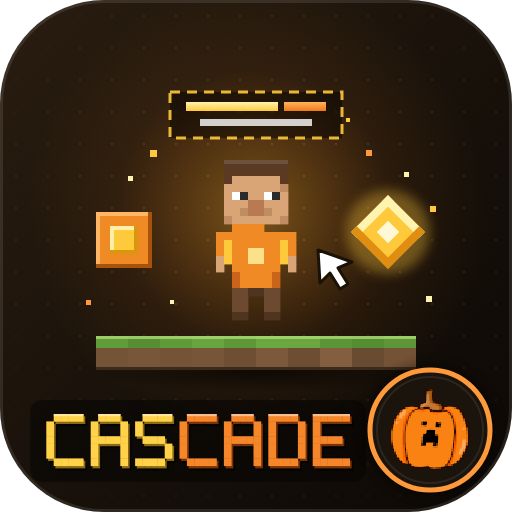
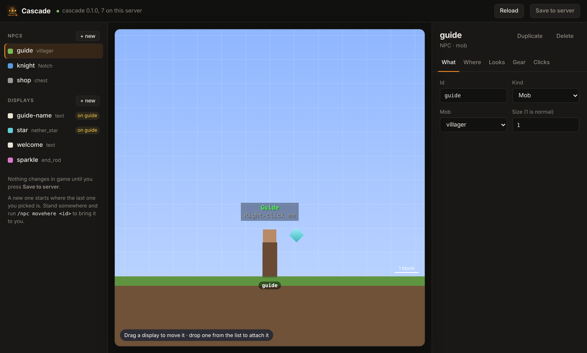

# Cascade



NPCs and displays for [Pumpkin](https://github.com/Pumpkin-MC/Pumpkin) servers.

- **NPCs** can be anything: a player with a skin, any mob, a block or an item.
- **Displays** are text displays, item displays, block displays and streams of particles.
- A display can be **attached to an NPC**, such as a name above its head, and goes wherever the NPC goes.
- Both can glow, be scaled, and **do things when clicked**: send a message, run a command, play a sound, teleport the player.

Everything is made in game with `/npc` and `/display`, or in your browser with the built-in **web editor**, and saved in one file you can also edit by hand.

Built for Pumpkin 0.2.2 (Minecraft 26.3).

## Install

1. Download `Cascade.wasm` from the [latest release](https://github.com/Xathr/Cascade/releases/latest).
2. Put it in your server's `plugins` folder (Linux and Windows alike).
3. Start the server. The first time, Pumpkin asks in the console whether Cascade may read and write its own data folder (`fs.read.data`, `fs.write.data`) and open a port for the web editor (`network.tcp`); answer yes.

The commands need the permission `cascade:admin`, which operators of level 2 and up have.

## Quick start

Stand where the NPC should be and type:

```
/npc create guide villager
/npc action guide add right message &aWelcome, %player%!
/npc action guide add right sound entity.villager.yes
/display create guide-name text &aGuide|&7Right-click me
/display attach guide-name guide
```

A player NPC with a skin, holding a sword, that sends players to spawn:

```
/npc create knight player Notch
/npc equip knight mainhand diamond_sword
/npc action knight add any teleport 0 80 0
```

A floating title, a turning item and some sparkle:

```
/display create welcome text &6&lWelcome|&7to the server
/display create prize item nether_star
/display create sparkle particle end_rod
```

## The web editor

Type `/npc web` (or `/display web`) and click **open the editor**.



- **Left:** every NPC and display. Pick one to work on it.
- **Middle:** the NPC from the side, with the displays attached to it. Drag a display to move it; drop one from the list onto the NPC to attach it. For something that stands on its own, the middle is a map from above: drag to move it.
- **Right:** its settings: kind, text with a live preview of the colours, position, looks, gear and click actions.

**Save to server** puts the changes in the game at once.

- The link holds a secret that changes every time the server starts, so only someone you give the link to can use the editor. Anyone with the link can change your NPCs and displays, so don't post it.
- The editor uses port 8787. Open that port on your host or firewall if you connect from another machine.
- In `plugins/data/cascade/config.toml`: `web_port` changes the port (0 switches the editor off), and `web_address` sets the address used in the link if the one worked out for you is wrong.
- The page is served over plain http. On a server reached over the internet, treat the link like a password for that session.

## NPCs: `/npc`

`<id>` is a short name you choose (letters, numbers, `-` and `_`). Press Tab as you type: the commands, mob types, particles, slots and other fixed choices complete themselves. Names of your NPCs, items and blocks are typed by hand.

| Command | What it does |
|---|---|
| `create <id> player [skin]` | A player-shaped NPC, wearing the skin of the named player |
| `create <id> <mob>` | Any mob: `villager`, `zombie`, `iron_golem`, `cat`, ... |
| `create <id> block <block>` | A block; leave the name out to use the one in your hand |
| `create <id> item <item>` | An item, likewise |
| `remove <id>` | Delete it |
| `list`, `info <id>` | See what exists |
| `movehere <id>`, `tp <id>` | Bring it to you, or go to it |
| `rotate <id> <yaw> [pitch]` | Turn it |
| `look <id> [on\|off] [blocks]` | Face the nearest player within that many blocks (on for players and mobs) |
| `skin <id> <player name>` | Change a player NPC's skin |
| `type <id> <mob>` | Turn it into another mob |
| `equip <id> <slot> [item\|hand\|none]` | Gear: `mainhand`, `offhand`, `head`, `chest`, `legs`, `feet` |
| `scale <id> <n>`, `glow <id>`, `baby <id>`, `sneak <id>`, `invisible <id>` | Looks; the last four switch on and off |
| `action ...`, `cooldown`, `permission` | See [Clicks](#clicks) |
| `web` | Give you the link to the web editor |
| `reload` | Read `things.json` again |

## Displays: `/display`

| Command | What it does |
|---|---|
| `create <id> text <line\|line\|...>` | Floating text |
| `create <id> item <item>` | A floating item, turning slowly |
| `create <id> block <block>` | A block that is not really there |
| `create <id> particle <name>` | A stream of particles: `flame`, `heart`, `end_rod`, ... |
| `text <id> <line\|line\|...>` | Set the text; `\|` starts a new line, `&` colours |
| `addline <id> <text>`, `setline <id> <n> <text>`, `removeline <id> <n>` | Edit one line |
| `attach <id> <npc> [height]` | Fix the display to an NPC, above its head unless you give a height |
| `detach <id>` | Let it stand on its own again, where it is |
| `offset <id> <x> <y> <z>` | Where an attached display sits, measured from its NPC |
| `item <id> <item>`, `block <id> <block>`, `particle <id> <name>` | Change what is shown |
| `scale <id> <n>`, `glow <id>` | Size, outline |
| `billboard <id> <center\|fixed\|vertical\|horizontal>` | How it turns to face the viewer |
| `spin <id> <degrees per second>` | Keep turning; 0 to stop |
| `background <id> <#AARRGGBB\|none>`, `shadow <id>`, `seethrough <id>` | How text looks |
| `width <id> <n>`, `align <id> <center\|left\|right>` | Text layout |
| `range <id> <n>` | How far away it can be seen (1 is normal) |
| `count`, `interval`, `spread`, `speed <id> <n>` | Particles: how many, ticks between bursts, how wide, how fast |
| `remove`, `list`, `info`, `movehere`, `tp`, `rotate`, `action`, `cooldown`, `permission`, `reload` | As for NPCs |

Display settings work on block and item NPCs too, and NPC settings on displays: they are the same thing underneath, kept in two lists.

### Names and other things on an NPC

An NPC has no text of its own. Make a text display and attach it:

```
/display create guide-name text &aGuide|&7Right-click me
/display attach guide-name guide
```

Any display can be attached: a turning item above a shopkeeper, particles around a wizard. Attached displays move with the NPC and are left standing, detached, if the NPC is removed. Names saved on NPCs by earlier versions are turned into attached text displays called `<npc>-name` the first time the plugin loads them.

## Clicks

```
/npc action <id> add <any|left|right> <what> <value>
/npc action <id> list
/npc action <id> remove <n>
/npc action <id> clear
```

| What | Value |
|---|---|
| `message` | Text sent to the player who clicked |
| `broadcast` | Text sent to everyone |
| `actionbar` | Text shown above the player's hotbar |
| `title` | `Title\|Subtitle` shown to the player |
| `console` | A command run by the console |
| `player` | A command run as the player |
| `sound` | A sound played to the player, such as `entity.experience_orb.pickup` |
| `teleport` | `x y z`, or `x y z world` |

In a value, `%player%` is the name of the player who clicked and `%id%` the thing clicked. A thing can have many actions; they run in order.

- `cooldown <id> <seconds>` is how long a player waits between clicks (half a second at first).
- `permission <id> <node>` limits clicking to players with that permission; `none` lifts it.

## The file

Everything is saved in `plugins/data/cascade/things.json` each time you change something. You can edit it by hand and run `/npc reload`. Settings you leave out take their usual value.

## Things to know

- **Colours in the console:** `plugins/data/cascade/config.toml` has `console_colors = true`; set it to `false` for plain text.

- **Left clicks:** Pumpkin 0.2.2 only reports a left click on mob NPCs. On players, blocks, items and text, use `right` or `any`; the command reminds you.
- **Skins:** the game client looks a skin up from the player name, so the name must be a real account.
- **Far away:** an NPC or display is only placed in the world while a player is within 48 blocks, and taken away when everyone is more than 64 blocks off.
- **Blocks:** a block NPC or display snaps to the block grid when created.
- NPCs don't move, can't be hurt and make no sound.
- **Daylight:** zombies, skeletons and their kin would stand burning in the sun. Cascade puts a stone button on their head, which is what stops it; choose your own head gear with `/npc equip <id> head <item>` to replace it.
- **Baby and sneak:** `/npc baby` and `/npc sneak` are saved, but Pumpkin 0.2.2 does not show either to players yet.

## Build from source

```bash
./build.sh          # needs Rust; adds the wasm32-wasip2 target itself (.\build.ps1 on Windows)
cargo test          # tests of the commands and the saved file
```

## Licence

GPL-3.0. See [LICENSE](LICENSE).
