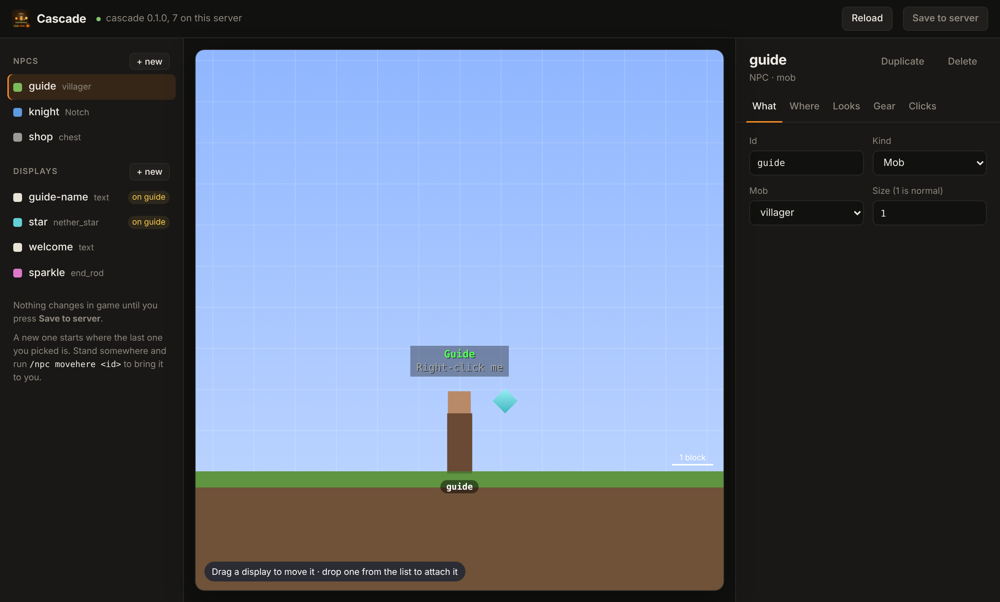

# Cascade — NPCs and displays, with a web editor

**Cascade** adds NPCs and displays to your Pumpkin server, and lets you set them up in game or in your browser.

- **NPCs of any kind:** a player with a skin, any mob, a block or an item.
- **Displays:** text displays, item displays, block displays and streams of particles.
- **Attach a display to an NPC:** a name above its head, a turning item beside it, particles around it. It goes wherever the NPC goes.
- **Clicks do things:** send a message, run a command as the console or the player, play a sound, show a title, teleport the player. With a wait between clicks and an optional permission.
- **Web editor:** type `/npc web`, open the link, and edit everything on a page: drag displays into place around an NPC, drag things around a map, change text with a live colour preview, then save straight to the server.
- **Commands with Tab completion:** `/npc` and `/display` for everything the editor does.



## Install

1. Put `Cascade.wasm` in your server's `plugins` folder.
2. Start the server and answer yes when Pumpkin asks about the plugin's permissions: its own data folder, and a port for the web editor.
3. Run `/npc help`.

## Quick start

```
/npc create guide villager
/npc action guide add right message &aWelcome, %player%!
/display create guide-name text &aGuide|&7Right-click me
/display attach guide-name guide
```

## Good to know

- Built for Pumpkin 0.2.2 (Minecraft 26.3).
- The web editor uses port 8787 and a secret link that changes each time the server starts. Set `web_port = 0` in the plugin's `config.toml` to switch it off.
- Pumpkin only reports left clicks on mob NPCs; use right clicks elsewhere.
- NPCs stand still, can't be hurt and make no sound.

Open source under GPL-3.0. Full command list in the README on GitHub.
